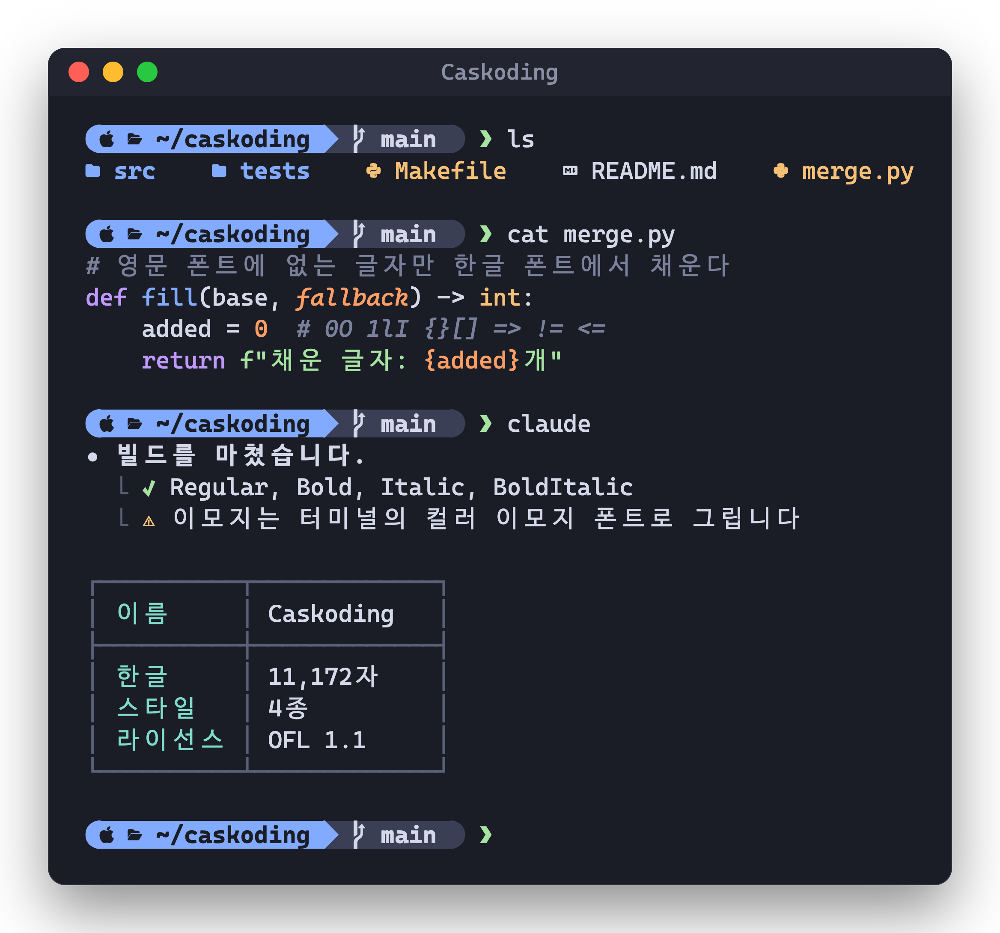
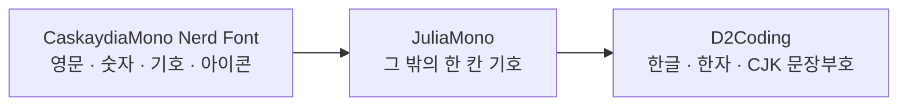

<div align="center">

# Caskoding

**영문은 Cascadia, 한글은 D2Coding. 한 폰트 안에서 정확히 두 칸.**

CaskaydiaMono Nerd Font에 D2Coding 한글을 합치고, 빠진 기호는 JuliaMono로 채운 터미널용 고정폭 폰트입니다.

[](LICENSE)
[](https://github.com/ryanoasis/nerd-fonts)
[](https://github.com/naver/d2-coding-font)


[설치](#설치) · [터미널 설정](#터미널-설정) · [구성](#구성) · [라이선스](#라이선스)



</div>

## 왜 Caskoding인가

영문 폰트에 한글 폰트를 따로 붙여 쓰면 한글만 크게 보이거나 줄이 어긋나곤 합니다. Caskoding은 한글을 처음부터 같은 폰트 안에 넣어서 영문과 한글의 크기와 간격이 잘 맞습니다.

| | |
|---|---|
| **한글 두 칸, 영문 한 칸** | 한글이 정확히 영문 두 글자 폭이라 표와 정렬이 어긋나지 않습니다. |
| **Nerd Font 아이콘 그대로** | 프롬프트, 파일 아이콘, Powerline 기호를 CaskaydiaMono 그대로 씁니다. |
| **빠진 기호 채움** | `⎿ ⏺ ✔ ⚠ ①` 같은 기호도 다른 폰트로 넘어가지 않고 같은 결로 그립니다. |
| **4가지 스타일** | Regular, Bold, Italic, BoldItalic. 터미널과 에디터가 쓰는 조합을 모두 갖췄습니다. |

## 설치

[uv](https://docs.astral.sh/uv/)가 필요합니다.

```sh
git clone https://github.com/kimmojae/caskoding.git
cd caskoding
make install
```

`make install`은 원본 폰트를 내려받아 빌드한 뒤 `~/Library/Fonts`에 복사합니다.

| 명령 | 하는 일 |
|---|---|
| `make install` | 원본 내려받기 → 빌드 → `~/Library/Fonts`에 복사 |
| `make fonts` | 빌드만 합니다. 결과는 `fonts/`에 생깁니다. |
| `make uninstall` | `~/Library/Fonts/Caskoding-*.ttf`를 지웁니다. |
| `make test` | 테스트를 실행합니다. |

## 터미널 설정

**Ghostty**

```
font-family = "Caskoding"
```

> [!NOTE]
> 설치하거나 다시 설치한 뒤에는 Ghostty를 완전히 종료하고 다시 실행해야 새 폰트를 인식합니다.

<details>
<summary><b>VS Code</b></summary>

```json
{
  "editor.fontFamily": "Caskoding",
  "terminal.integrated.fontFamily": "Caskoding"
}
```

</details>

<details>
<summary><b>iTerm2</b></summary>

Settings → Profiles → Text → Font에서 `Caskoding`을 고릅니다.

</details>

## 구성

글자는 아래 순서로 찾습니다. 앞 폰트에 있으면 그 글자를 쓰고, 없을 때만 다음 폰트에서 채웁니다.



| 부분 | 원본 | 버전 |
|---|---|---|
| 영문, 기호, 아이콘 | [CaskaydiaMono Nerd Font Mono](https://github.com/ryanoasis/nerd-fonts) (Cascadia Mono 기반) | Nerd Fonts v3.5.1 |
| 그 밖의 한 칸 기호 (`⎿ ⏺ ✔ ⚠ ①`, 화살표, 수학 기호 등) | [JuliaMono](https://github.com/cormullion/juliamono) | 0.63.2 |
| 한글 (완성형 11,172자, 호환 자모), 한자, CJK 문장부호 | [D2Coding](https://github.com/naver/d2-coding-font) | 1.4.0 |

원본은 빌드할 때 공식 릴리스에서 내려받으며, 체크섬으로 확인합니다.

<details>
<summary><b>어떤 글자를 어디서 가져오나요?</b></summary>

- JuliaMono는 터미널에서 한 칸을 차지하는 글자만 채웁니다. Cascadia와 같은 고정폭 산세리프이고, 각 스타일에 가까운 굵기를 씁니다.
- D2Coding은 두 칸을 차지하는 글자(한글, 한자 등)와 남은 글자를 채웁니다. D2Coding이 두 칸으로 그리는데 터미널은 한 칸으로 다루는 글자는 옆 글자와 겹치므로 D2Coding에서 가져오지 않습니다.
- 이모지는 넣지 않습니다. 터미널이 컬러 이모지 폰트로 그립니다.

</details>

<details>
<summary><b>왜 스타일이 4종뿐인가요?</b></summary>

터미널과 에디터가 쓰는 조합이 Regular, Bold, Italic, BoldItalic 4개입니다. D2Coding에도 Regular와 Bold만 있어서, 굵기를 더 나눠도 한글 굵기는 따라오지 않습니다. 이탤릭에서도 한글은 기울이지 않습니다.

</details>

## 라이선스

[SIL Open Font License 1.1](LICENSE)입니다. 세 원본도 모두 OFL이며, 원본 라이선스 전문은 [licenses/](licenses/)에 있습니다.

OFL은 원본의 예약 이름(Reserved Font Name)을 수정본에 쓰지 못하게 합니다. 이 폰트가 "Cascadia Code"나 "D2Coding", "JuliaMono"가 아니라 "Caskoding"이라는 이름을 쓰는 이유입니다.

<div align="center">
<sub>Built on <a href="https://github.com/microsoft/cascadia-code">Cascadia Code</a>, <a href="https://github.com/naver/d2-coding-font">D2Coding</a>, and <a href="https://github.com/cormullion/juliamono">JuliaMono</a>.</sub>
</div>
